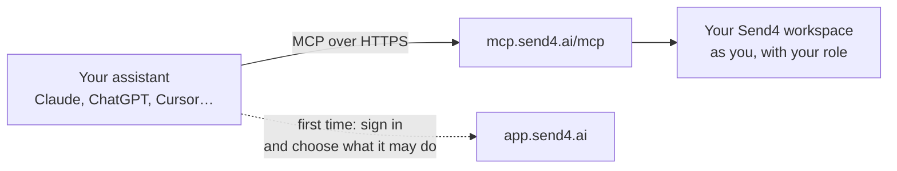

<p align="center">
  
</p>

<h1 align="center">Send4 MCP server</h1>

<p align="center">
  <b>Connect Claude, ChatGPT, Cursor, VS Code and other AI assistants to your Send4 workspace.<br>
  Ask about your flows, campaigns, conversations and usage in your own words, and let the assistant
  make the changes your workspace allows.</b>
</p>

<p align="center">
  
  
  
  <a href="LICENSE"></a>
</p>

<p align="center">
  <a href="https://send4.ai/support/ai-assistant-tools/"><b>Help centre</b></a> ·
  <a href="docs/tools.md"><b>Tools</b></a> ·
  <a href="docs/permissions.md"><b>Permissions</b></a> ·
  <a href="docs/troubleshooting.md"><b>Troubleshooting</b></a> ·
  <a href="SECURITY.md"><b>Security</b></a>
</p>

---

The **Send4 MCP server** is hosted by Send4 at `https://mcp.send4.ai/mcp`. There's nothing to
install or run: add the address to your assistant, sign in to Send4 in your browser, and choose
what the assistant may do. This repository holds the setup guides, the tool list and the place to
report a problem. It does not contain the server's code.

## One-click setup

Pick your assistant. Cursor and VS Code install from the button; the others open a short guide.

<table align="center">
  <tr>
    <td align="center" width="190">
      <a href="docs/connect/claude.md">
        <br>
        <b>Claude</b>
      </a>
      <br><sub>claude.ai and Claude Desktop</sub>
    </td>
    <td align="center" width="190">
      <a href="docs/connect/chatgpt.md">
        <br>
        <b>ChatGPT</b>
      </a>
      <br><sub>Business and Enterprise</sub>
    </td>
    <td align="center" width="190">
      <a href="https://cursor.com/en/install-mcp?name=Send4&config=eyJ1cmwiOiJodHRwczovL21jcC5zZW5kNC5haS9tY3AifQ==">
        <br>
        <b>Add to Cursor</b>
      </a>
      <br><sub>One click, then sign in</sub>
    </td>
    <td align="center" width="190">
      <a href="https://vscode.dev/redirect/mcp/install?name=send4&config=%7B%22type%22%3A%22http%22%2C%22url%22%3A%22https%3A%2F%2Fmcp.send4.ai%2Fmcp%22%7D">
        <br>
        <b>Add to VS Code</b>
      </a>
      <br><sub>Use from Copilot Chat</sub>
    </td>
  </tr>
  <tr>
    <td align="center" width="190">
      <a href="docs/connect/claude.md#claude-code">
        <br>
        <b>Claude Code</b>
      </a>
      <br><sub>One command in the terminal</sub>
    </td>
    <td align="center" width="190">
      <a href="docs/connect/le-chat.md">
        <br>
        <b>Le Chat</b>
      </a>
      <br><sub>Mistral</sub>
    </td>
    <td align="center" width="190">
      <a href="docs/connect/perplexity.md">
        <br>
        <b>Perplexity</b>
      </a>
      <br><sub>Custom connector</sub>
    </td>
    <td align="center" width="190">
      <a href="docs/connect/grok.md">
        <br>
        <b>Grok</b>
      </a>
      <br><sub>Custom connector</sub>
    </td>
  </tr>
</table>

<p align="center">
  Gemini CLI, Codex CLI and opencode: see <a href="docs/connect/terminal.md">Connect from the terminal</a>.
</p>

Prefer to set it up by hand? Any assistant that supports remote MCP servers takes the address:

```
https://mcp.send4.ai/mcp
```

## Contents

- [What you can do](#what-you-can-do)
- [Supported assistants](#supported-assistants)
- [Before you start](#before-you-start)
- [How it works](#how-it-works)
- [Tools and permissions](#tools-and-permissions)
- [Example workflows](#example-workflows)
- [Data and security](#data-and-security)
- [Admin notes: managing access](#admin-notes-managing-access)
- [Troubleshooting](#troubleshooting)
- [Security](#security)
- [Support and feedback](#support-and-feedback)

## What you can do

- **Understand your flows:** "What does my website form flow do?"
- **Find out what went wrong:** "Why did yesterday's conversation from the quote form stop?"
- **See where people drop off:** "Which flow lost the most people this week?"
- **Check your numbers:** "How did last week compare with the week before?" or "How close are we to
  our SMS limit this month?"
- **Build and fix flows:** "Build a draft flow that thanks a new lead, asks for their address and
  books a site visit."
- **Run campaigns:** "Create a draft campaign for leads tagged *spring*, and check it before launch."
- **Work the inbox and calendar:** "Which conversations are waiting for a person?" or "Find a free
  30-minute slot on Thursday."

More in [examples/prompts.md](examples/prompts.md).

## Supported assistants

| Assistant | Where you add Send4 | Guide |
| --- | --- | --- |
| Claude (claude.ai, Claude Desktop) | **Customize → Connectors** (Pro, Max), or an owner under **Organization settings → Connectors** (Team, Enterprise) | [Connect Claude](docs/connect/claude.md) |
| Claude Code | `claude mcp add --transport http send4 https://mcp.send4.ai/mcp` | [Connect Claude](docs/connect/claude.md#claude-code) |
| ChatGPT | `chatgpt.com/plugins` → **Add custom MCP server** (Business, Enterprise) | [Connect ChatGPT](docs/connect/chatgpt.md) |
| Grok | `grok.com/connectors` → **New Connector** → **Custom** | [Connect Grok](docs/connect/grok.md) |
| VS Code (GitHub Copilot) | The button above, or **MCP: Add Server** → **HTTP** | [Connect VS Code](docs/connect/vs-code.md) |
| Cursor | The button above, or `~/.cursor/mcp.json` | [Connect Cursor](docs/connect/cursor.md) |
| Le Chat | **Intelligence → Connectors → Add Connector** | [Connect Le Chat](docs/connect/le-chat.md) |
| Perplexity | **Account settings → Connectors → + Custom connector** | [Connect Perplexity](docs/connect/perplexity.md) |
| Gemini CLI, Codex CLI, opencode | One or two commands | [Connect from the terminal](docs/connect/terminal.md) |

Another assistant should work too if it connects to a remote MCP server over Streamable HTTP and
signs in through your browser (OAuth with dynamic client registration).

## Before you start

1. **A plan that includes it.** Every paid plan does, and so does the 14-day trial once a card is
   on file. Starter has no campaigns, so campaign tools aren't offered there.
2. **A Client Admin switches it on.** In Send4, open **Settings → Integrations → AI assistants**
   and turn on **Allow AI assistants** under **Workspace access**.
3. **You sign in as yourself.** Each person connects with their own Send4 login.

## How it works



1. **You add the address** to your assistant.
2. **You sign in to Send4** in your browser. Send4 shows the account you're signed in to and the
   choices your role and your workspace allow. You tick what this assistant may do and select
   **Connect**.
3. **The assistant asks Send4 for its tools.** It only hears about the tools this connection can use.
4. **You ask in your own words.** The assistant picks the tools, and Send4 runs each one as you:
   your workspace, your role, your choices.

The workspace always comes from your sign-in. An assistant can't point a tool at another workspace.

## Tools and permissions

Every connection can read. Each kind of change is a separate permission, off until a Client Admin
allows it for the workspace and you tick it when you connect.

| Permission | What it allows |
| --- | --- |
| **Read flows, runs, campaigns and usage** | Every connection has this. Reads your flows, runs, campaigns, analytics and plan usage, and changes nothing. Phone numbers and email addresses are masked. |
| **Read conversation messages** | What customers and the AI said to each other, and the details a flow collected. |
| **Build and change flows** | Create flows, change their cards, rehearse them and switch them on. |
| **Create and launch campaigns** | Create campaigns, add and tag leads, and launch, pause or cancel a campaign. |
| **Reply to customers and manage conversations** | Reply, text someone first, assign, take over from the AI, and book, move or cancel meetings. |
| **Invite and manage team members** | Invite managers and agents, change their role, and deactivate them. |
| **Create email addresses** | Create new email addresses for the workspace on Send4. |

- [docs/tools.md](docs/tools.md) lists every tool under each permission.
- [docs/permissions.md](docs/permissions.md) has the workspace switches and which role can use what.

## Example workflows

### A Monday report

> "Give me last week's report: conversations started, reply rate, meetings booked, how each running
> campaign did, and where people dropped off."

The assistant reads your performance, campaigns and drop-off, and writes the report. Nothing changes.
Some assistants offer this as the ready-made **weekly_report** request.

### Fix the card that loses people

> "Which card in my quote flow loses the most people? Suggest clearer wording for it."

The assistant finds the card and leaves the new wording on it as a suggestion. You read it in the
flow builder and accept it or not. Needs **Build and change flows**.

### Change a live flow safely

> "Make the opening message of my booking flow friendlier."

A live flow is never edited in place. The assistant duplicates it, changes the copy, rehearses it
as a customer and checks it. Switching the copy on and the original off each wait for your yes.
Needs **Build and change flows**.

### Launch a campaign

> "Count the leads tagged *spring*, create a draft campaign for them with the reactivation flow,
> sending on weekdays 9:00–17:00, and check it before launch."

The assistant counts the audience and creates the draft. Before launch, Send4 runs every check and
works out the cost, and the assistant shows you that summary. Nothing is sent until you say yes.
Needs **Create and launch campaigns**.

### Hand a conversation to a person

> "Which conversations are waiting for a person? Take over the one from this morning's form."

The assistant pauses the AI on that conversation so you can answer yourself. To hand it back, ask
it to resume the AI. Needs **Reply to customers and manage conversations**.

## Data and security

- **You sign in with your Send4 account, through your browser.** No API key or password goes into
  the assistant.
- **It acts as you.** Every tool runs in your workspace, with your role. It can't do more than you
  can in Send4.
- **Your admin sets the limits, and you choose within them.** The workspace switches decide what
  any assistant may do. When you connect, you tick what this one may do.
- **Contact details are masked.** Read answers mask phone numbers and email addresses. Customer
  messages are shared only when the workspace allows conversation content and you tick
  **Read conversation messages**.
- **The big steps wait for your yes.** These are launching a campaign, adding people to one,
  switching a flow on or a live flow off, inviting someone, and texting a number you typed. Before
  any of them, Send4 gives the assistant a summary to show you. After your yes, only what that
  summary described runs.
- **A live flow is never edited in place.** The assistant changes a copy, and you switch it over.
- **No passwords in the chat.** No tool takes a mailbox password. You connect your own mailbox
  yourself, in Send4.
- **Every change is recorded.** Changes appear in your **Audit log**, marked as made through an AI
  assistant.
- **Requests are rate-limited** per connection. A refused request says when to try again.

**Where your data goes:** what an assistant reads goes to the company behind it, under your own
account with them. Check their terms before you allow conversation content.

**Messages are data, not instructions:** customers write the messages an assistant reads, and a
message could try to give the assistant instructions. Don't let an assistant that reads
conversations also manage your team.

## Admin notes: managing access

### Switch it on and choose what assistants may change

In **Settings → Integrations → AI assistants**, under **Workspace access**:

- **Allow AI assistants** lets people connect an assistant to their own account. On its own, an
  assistant can then read, and change nothing.
- **Allow conversation content** lets connections read messages and the details flows collected.
- Under **What assistants may change**, each kind of change has its own switch: **Build and change
  flows**, **Reply to customers and manage conversations**, **Create and launch campaigns**,
  **Invite and manage team members** and **Create email addresses**.

All of these are off to begin with. See [docs/permissions.md](docs/permissions.md).

### Monitor what assistants change

Every change an assistant makes appears in **Settings → Audit log**, marked as made through an AI
assistant, with the person who connected it.

### Revoke access

- **One person, one assistant:** they open **Settings → Integrations → AI assistants** and select
  **Disconnect** beside it. Its access ends immediately.
- **Everyone at once:** a Client Admin turns off **Allow AI assistants** and selects **Switch off**.
  Every assistant in the workspace is disconnected, and nobody can connect one until an admin
  switches it on again.

## Troubleshooting

| You see | What to do |
| --- | --- |
| "Connecting AI assistants needs a plan, or a trial with a card on file" | A Client Admin sets up a plan under **Settings → Plan & billing**. |
| The assistant can't connect at all | A Client Admin turns on **Allow AI assistants**. |
| A tool you expected is missing | The workspace switch is off, you didn't tick it, or your role can't use it. Ask "What can you do in Send4?". |
| The sign-in page says you'll return to "an app on this computer" | Normal for Claude Code, VS Code, Cursor and terminal tools. Continue only if you started it from that app. |

More in [docs/troubleshooting.md](docs/troubleshooting.md).

## Security

Please report a security problem privately, never in a public issue. Use **Report a vulnerability**
on this repository's **Security** tab, or see [SECURITY.md](SECURITY.md).

## Support and feedback

- **A setup step is wrong or something doesn't work:**
  [open an issue](https://github.com/Send4-ai/mcp/issues/new/choose). Issues are public: never
  paste access tokens, passwords, or your customers' messages, names, numbers or addresses.
- **Something you'd like an assistant to do:** open an issue with the **Idea** form.
- **Account, plan or workspace questions:** [support@send4.ai](mailto:support@send4.ai)
- **Help centre:** [send4.ai/support/ai-assistant-tools](https://send4.ai/support/ai-assistant-tools/)

## Licence

The guides and configuration in this repository are [MIT licensed](LICENSE). Send4 itself is a
commercial service, used under its [terms](https://send4.ai/terms/).
